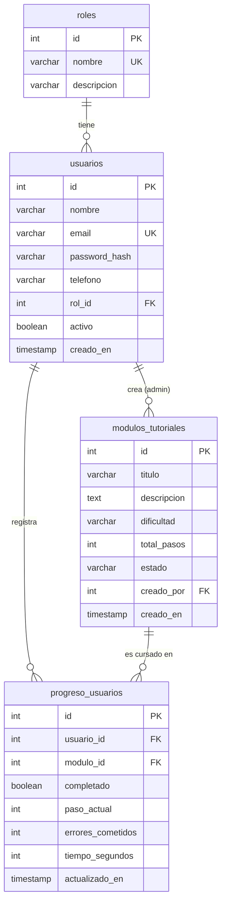

# Municipio Fácil: Backend API

API RESTful del proyecto **Municipio Fácil**, una app de alfabetización digital ciudadana. Desarrollada para la asignatura **Ingeniería Web y Móvil**.

> Esta rama (`backend`) contiene solo el servidor (Node.js + Express), la conexión a PostgreSQL y el script `database.sql`. La interfaz (Ionic + React) y la documentación de requerimientos están en la rama `frontend`.

---

## Tabla de contenidos

1. [Integrantes y responsabilidades](#1-integrantes-y-responsabilidades)
2. [Descripción del sistema](#2-descripción-del-sistema)
3. [Problema y objetivos](#3-problema-y-objetivos)
4. [Funcionalidades principales](#4-funcionalidades-principales)
5. [Tecnologías y herramientas](#5-tecnologías-y-herramientas)
6. [Arquitectura del backend](#6-arquitectura-del-backend)
7. [Modelo de base de datos](#7-modelo-de-base-de-datos)
8. [Instalación y configuración](#8-instalación-y-configuración)
9. [Ejecución y uso](#9-ejecución-y-uso)
10. [Documentación de la API](#10-documentación-de-la-api)
11. [Autenticación y roles](#11-autenticación-y-roles)
12. [Seguridad](#12-seguridad)
13. [Servicio externo](#13-servicio-externo)
14. [Pruebas](#14-pruebas)
15. [Flujo de trabajo Frontend + Backend](#15-flujo-de-trabajo-frontend--backend)
16. [Despliegue con Docker](#16-despliegue-con-docker)

---

## 1. Integrantes y responsabilidades

| Integrante | GitHub | Responsabilidad principal |
|---|---|---|
| Alexis Parra | [@AlexisEstebanParraS](https://github.com/AlexisEstebanParraS) | Flujo del ciudadano: progreso con control de dueño (`/progreso`), pantallas Practicar, Lección e Inicio |
| Fernando Pacheco | [@F3rsj](https://github.com/F3rsj) | Seguridad y sesión: JWT, CORS, rate limit, helmet, XSS, cliente HTTP del frontend, servicio externo de correo |
| Gabriel Díaz | [@Gabread](https://github.com/Gabread) | Administración y datos: módulos, usuarios, métricas, `database.sql`, índices, paginación, script `crear-admin` |
| Israel Pérez | [@Y63431](https://github.com/Y63431) | Despliegue y perfil: Docker y docker-compose, `/usuarios/me`, health, Mi Perfil |

Cada integrante trabaja un corte completo (base de datos, backend, frontend, pruebas y documentación de su parte), y cada cambio entra por Pull Request revisado por otro integrante.

---

## 2. Descripción del sistema

**Municipio Fácil** enseña a los ciudadanos a realizar trámites municipales en línea mediante módulos tutoriales paso a paso (por ejemplo, solicitar un trámite, consultar su estado o descargar un certificado).

Este repositorio es el backend: expone una API REST que gestiona usuarios, módulos tutoriales y el progreso de aprendizaje de cada persona, y entrega métricas a los funcionarios municipales.

Hay dos roles:

- **ciudadano:** realiza los módulos y ve solo su propio progreso.
- **admin:** funcionario municipal que administra los módulos, consulta usuarios y revisa métricas.

---

## 3. Problema y objetivos

**Problema.** Muchas personas, en especial adultos mayores, no tienen la experiencia digital necesaria para usar los portales municipales, y terminan dependiendo de la atención presencial. Los funcionarios, por su parte, no tienen cómo medir dónde se equivocan o abandonan los usuarios.

**Objetivo general.** Proveer un servidor seguro que sostenga una plataforma de capacitación digital para ciudadanos, con seguimiento de su aprendizaje.

**Objetivos específicos del backend**

- Registrar y autenticar usuarios con JWT y contraseñas cifradas con bcrypt.
- Diferenciar permisos entre ciudadano y administrador.
- Administrar el catálogo de módulos tutoriales (CRUD).
- Registrar el progreso, los errores y el tiempo de cada ciudadano.
- Entregar métricas agregadas (tasa de error, abandono, módulos más difíciles).

> Los requerimientos funcionales y no funcionales están documentados en la rama `frontend`.

---

## 4. Funcionalidades principales

- Registro e inicio de sesión con validación de datos.
- Catálogo de módulos con filtros por estado y dificultad.
- CRUD de módulos restringido al rol `admin`.
- Seguimiento de progreso por usuario (paso actual, errores, tiempo, completado).
- Panel administrativo: listado de usuarios y métricas de uso.
- Respuestas JSON uniformes y manejo centralizado de errores.

---

## 5. Tecnologías y herramientas

| Área | Tecnología |
|---|---|
| Entorno de ejecución | Node.js 18+ |
| Framework | Express |
| Base de datos | PostgreSQL |
| Driver de BD | `pg` (consultas parametrizadas) |
| Autenticación | `jsonwebtoken` (JWT) |
| Cifrado de contraseñas | `bcrypt` |
| Configuración | `dotenv` |
| CORS | `cors` |
| Pruebas de API | Insomnia |
| Control de versiones | Git y GitHub |

---

## 6. Arquitectura del backend

```
.
├── database.sql                # Crea la BD, tablas, índices y datos iniciales
├── Dockerfile                  # Imagen de la API
├── docker-compose.yml          # Orquesta db + api + web
├── .env.example                # Plantilla de variables de entorno
├── scripts/
│   └── crear_admin.js          # npm run crear-admin
├── docs/
│   └── insomnia_collection.json  # Pruebas de la API en Insomnia
└── src/
    ├── app.js                  # Express: helmet, CORS, JSON y rutas
    ├── config/db.js            # Pool de conexión a PostgreSQL
    ├── routes/                 # Endpoints, protección por rol y límite de login
    ├── controllers/            # Lógica HTTP: valida la petición y arma la respuesta
    ├── services/               # Acceso a datos (SQL) y servicio externo de correo
    ├── middlewares/
    │   ├── auth.js             # verificarToken, esAdmin, constantes de roles
    │   └── error.js            # ApiError, 404 y manejador global de errores
    └── util/
        ├── validacion.js       # Contrato de entrada, registro, login y protección contra HTML (XSS)
        └── parametros.js       # leerId y paginación
```

Es un **monolito modular organizado en capas** (Route → Controller → Service → Datos): se despliega como una unidad, pero cada capa tiene una responsabilidad.

| Capa | Responsabilidad |
|---|---|
| Route | Relaciona método + URL con una operación y aplica los middlewares |
| Middleware | Verifica el JWT (`verificarToken`) y el rol (`esAdmin`) antes de llegar a la ruta |
| Controller | Valida la entrada y coordina request y response |
| Service | Lógica y acceso a datos con SQL parametrizado |
| Datos | PostgreSQL |

Flujo de una petición: `ruta → middleware (JWT / rol) → controlador → servicio → PostgreSQL → respuesta JSON`. Los controladores no contienen SQL; los servicios no conocen `req` ni `res`. Los errores se lanzan como `ApiError` y se centralizan en un middleware de errores (Express 5 envía también los errores de funciones `async`).

---

## 7. Modelo de base de datos



**Restricciones de integridad relevantes**

- `usuarios.email` y `roles.nombre` son únicos.
- `modulos_tutoriales.dificultad` ∈ {`Facil`, `Media`, `Alta`}; `estado` ∈ {`Habilitado`, `Borrador`, `Deshabilitado`}; `total_pasos > 0`.
- `UNIQUE (usuario_id, modulo_id)` en `progreso_usuarios`: un usuario no puede iniciar dos veces el mismo módulo.
- `ON DELETE CASCADE` en el progreso (si se borra el usuario o el módulo), `ON DELETE RESTRICT` en `usuarios.rol_id`, y `ON DELETE SET NULL` en `creado_por`.

### Índices y rendimiento

Optimización de consultas (EF4):

- **Índice en la clave foránea `modulo_id`** de `progreso_usuarios` (`idx_progreso_modulo`): la usan las métricas por módulo y el borrado en cascada al eliminar un módulo. Las claves primarias y las restricciones `UNIQUE` ya tienen índice automático; el `UNIQUE (usuario_id, modulo_id)` sirve también para buscar el progreso de un usuario, por eso no se creó otro índice para `usuario_id`.
- **Solo las columnas necesarias:** las consultas nombran sus columnas en vez de `SELECT *`, y ninguna devuelve `password_hash`.
- **Paginación con `LIMIT` y `OFFSET`** en los listados de módulos y usuarios (`?page=1&limit=10`), para no enviar toda la tabla en una respuesta.
- **Filtros en la consulta:** el ciudadano recibe solo los módulos habilitados y solo su progreso, filtrados con `WHERE` en PostgreSQL y no después en JavaScript.

Un índice no es gratis: ocupa espacio y hace más lentas las escrituras (`INSERT`, `UPDATE`). Por eso solo se agregó donde una consulta frecuente filtra por esa columna.

---

## 8. Instalación y configuración

### Requisitos previos

- Node.js v18 o superior
- PostgreSQL (servicio activo)
- Git

### 1. Clonar el repositorio y cambiar a la rama `backend`

```bash
git clone https://github.com/Y63431/Alfabetizacion-Web.git
cd Alfabetizacion-Web
git checkout backend
```

### 2. Instalar dependencias

```bash
npm install
```

### 3. Configurar las variables de entorno

```bash
cp .env.example .env
```

Edita `.env` con tus valores locales. **Nunca subas `.env` a GitHub** (está en `.gitignore`).

| Variable | Descripción | Ejemplo |
|---|---|---|
| `PORT` | Puerto del servidor | `3000` |
| `DB_HOST` | Host de PostgreSQL | `localhost` |
| `DB_PORT` | Puerto de PostgreSQL | `5432` |
| `DB_USER` | Usuario de PostgreSQL | `postgres` |
| `DB_PASSWORD` | Contraseña de PostgreSQL | `tu_password_aqui` |
| `DB_NAME` | Nombre de la base de datos | `municipio-facil` |
| `JWT_SECRET` | Clave para firmar tokens (**obligatoria**, mínimo 32 caracteres aleatorios). Si falta, el servidor no inicia | `cadena_larga_y_aleatoria` |
| `JWT_EXPIRES_IN` | Duración del token | `2h` |
| `FRONTEND_ORIGIN` | Origen del frontend permitido por CORS (protocolo + host + puerto) | `http://localhost:5173` (con Docker: `http://localhost:8080`) |
| `RESEND_API_KEY` | Clave del servicio de correo (opcional; vacía = no se envían correos) | `re_...` |
| `CORREO_REMITENTE` | Remitente del correo de bienvenida | `"Municipio Fácil <onboarding@resend.dev>"` |
| `ADMIN_NOMBRE`, `ADMIN_EMAIL`, `ADMIN_PASSWORD` | Solo para `npm run crear-admin`; bórralos después | `"Cambia#Esta1"` |

> **Ojo con el `#`:** en un `.env`, un `#` sin comillas inicia un comentario. Si un valor tiene `#`, ponlo entre comillas.

Para generar un `JWT_SECRET` seguro:

```bash
node -e "console.log(require('crypto').randomBytes(48).toString('hex'))"
```

### 4. Crear e inicializar la base de datos

```bash
psql -U postgres -f database.sql
```

El script **crea la base de datos `municipio-facil` si no existe**, se conecta a ella y crea las 4 tablas, los índices, los roles (`ciudadano`, `admin`) y 4 módulos de ejemplo. Se puede ejecutar varias veces sin duplicar datos. Usa comandos propios de `psql` (`\gexec` y `\connect`), así que debe ejecutarse con `psql`, no desde pgAdmin.

### 5. Crear el primer administrador

Completa `ADMIN_NOMBRE`, `ADMIN_EMAIL` y `ADMIN_PASSWORD` en el `.env` y ejecuta:

```bash
npm run crear-admin
```

Crea la cuenta con rol `admin` (o asciende a admin una cuenta existente con ese correo). La contraseña se guarda con bcrypt; el repositorio no contiene ninguna contraseña real. Después, borra `ADMIN_PASSWORD` del `.env`. Los demás administradores se pueden crear desde la API (`PATCH /admin/usuarios/:id`).

---

## 9. Ejecución y uso

```bash
npm run dev
```

El servidor queda disponible en `http://localhost:3000/api`. Comprueba que funciona:

```bash
curl http://localhost:3000/api/health
# {"ok":true,"message":"API Municipio Fácil operativa","db":"ok"}
```

Las rutas protegidas requieren el encabezado:

```
Authorization: Bearer <TOKEN>
```

---

## 10. Documentación de la API

**URL base:** `http://localhost:3000/api`

### Formato de respuestas

Éxito:

```json
{ "ok": true, "message": "Módulo creado", "data": { } }
```

Las listas añaden `"total": <n>`. Los listados de módulos y usuarios aceptan paginación opcional con query params `?page=1&limit=10` (máximo 100) y entonces añaden `page` y `limit`. Error:

```json
{ "ok": false, "error": { "mensaje": "Datos inválidos", "detalles": ["titulo es obligatorio"] } }
```

### Resumen de endpoints

| Método | Ruta | Acceso | Descripción |
|---|---|---|---|
| GET | `/health` | Público | Estado del servidor y de la base de datos |
| POST | `/auth/registro` | Público | Registrar ciudadano |
| POST | `/auth/login` | Público | Iniciar sesión |
| GET | `/modulos` | Autenticado | Listar módulos |
| GET | `/modulos/:id` | Autenticado | Obtener un módulo |
| POST | `/modulos` | **admin** | Crear módulo |
| PUT | `/modulos/:id` | **admin** | Reemplazar módulo |
| PATCH | `/modulos/:id` | **admin** | Modificar campos de un módulo |
| DELETE | `/modulos/:id` | **admin** | Eliminar módulo |
| GET | `/progreso` | Autenticado | Listar progreso (propio, o todos si es admin) |
| GET | `/progreso/:id` | Autenticado (dueño o admin) | Obtener un progreso |
| POST | `/progreso` | Autenticado | Iniciar un módulo |
| PATCH | `/progreso/:id` | Autenticado (dueño o admin) | Actualizar avance |
| DELETE | `/progreso/:id` | Autenticado (dueño o admin) | Eliminar progreso |
| GET | `/admin/usuarios` | **admin** | Listar usuarios |
| PATCH | `/admin/usuarios/:id` | **admin** | Activar/desactivar una cuenta o cambiar su rol |
| GET | `/admin/metricas` | **admin** | Métricas de aprendizaje |
| GET | `/usuarios/me` | Autenticado | Ver mi perfil |
| PUT | `/usuarios/me` | Autenticado | Actualizar mi nombre y teléfono |

### Códigos HTTP utilizados

| Código | Significado en esta API |
|---|---|
| 200 / 201 | Operación exitosa / recurso creado |
| 400 | Datos inválidos, campos no permitidos, JSON mal formado o id con formato incorrecto |
| 401 | Falta el token o es inválido/expirado, o credenciales incorrectas |
| 403 | Autenticado, pero sin permiso: falta el rol o el recurso pertenece a otro usuario |
| 404 | El recurso no existe |
| 409 | Valor duplicado (ej.: email repetido) o referencia inválida |
| 429 | Más de 10 intentos de login en 15 minutos |
| 500 | Error interno (sin detalles sensibles) |
| 503 | `/health`: la base de datos no responde |

---

### Autenticación

#### `POST /auth/registro`

Crea un usuario con rol `ciudadano` y devuelve un token.

```json
{
  "nombre": "María González",
  "email": "maria@correo.cl",
  "password": "Clave#2026",
  "telefono": "+56 9 1234 5678"
}
```

| Campo | Obligatorio | Regla |
|---|---|---|
| `nombre` | Sí | Máx. 100 caracteres, sin `<` ni `>` |
| `email` | Sí | Formato válido, máx. 150 caracteres (cualquier dominio) |
| `password` | Sí | Mín. 8 caracteres, con minúscula, mayúscula, número y carácter especial |
| `telefono` | No | Formato `+56 9 1234 5678` (7 a 20 caracteres numéricos, espacios, `+`, `()`, `-`) |

**201:**

```json
{
  "ok": true,
  "message": "Usuario registrado con éxito",
  "data": {
    "usuario": { "id": 3, "nombre": "María González", "email": "maria@correo.cl", "telefono": "+56 9 1234 5678", "rol_id": 1, "creado_en": "2026-10-25T21:00:00.000Z" },
    "token": "eyJhbGciOi..."
  }
}
```

Además, si `RESEND_API_KEY` está configurada, se envía un correo de bienvenida (ver [Servicio externo](#13-servicio-externo)).

**Errores:** `400` validación · `409` email ya registrado · `429` demasiados intentos.

#### `POST /auth/login`

```json
{ "email": "maria@correo.cl", "password": "Clave#2026" }
```

**200:** misma estructura que el registro (sin `password_hash`).
**Errores:** `400` campos faltantes o email inválido · `401` credenciales incorrectas o cuenta desactivada (mismo mensaje para email inexistente y contraseña errónea) · `429` demasiados intentos fallidos.

---

### Módulos

#### `GET /modulos`

Parámetros opcionales: `estado` (`Habilitado`, `Borrador`, `Deshabilitado`), `dificultad` (`Facil`, `Media`, `Alta`), `page`, `limit`. Un **ciudadano solo ve módulos `Habilitado`**; el admin ve todos y puede filtrar por estado. Un valor de filtro no permitido responde `400`.

```
GET /api/modulos?dificultad=Facil
```

**200:**

```json
{
  "ok": true,
  "total": 2,
  "data": [
    { "id": 1, "titulo": "Solicitar Trámite", "descripcion": "...", "dificultad": "Facil", "total_pasos": 3, "estado": "Habilitado", "creado_por": null, "creado_en": "2026-10-16T19:00:00.000Z" }
  ]
}
```

**Errores:** `400` filtro o paginación inválidos · `401`.

#### `GET /modulos/:id`

**200:** `{ "ok": true, "data": { ...módulo } }` · **Errores:** `400` id inválido · `401` · `404` (no existe, o no está habilitado si eres ciudadano).

#### `POST /modulos` (admin)

```json
{
  "titulo": "Firmar un documento digital",
  "descripcion": "Aprende a firmar documentos con clave única.",
  "dificultad": "Media",
  "total_pasos": 5,
  "estado": "Borrador"
}
```

`titulo` (máx. 150) y `descripcion` son obligatorios y no pueden contener `<` ni `>`. Por defecto: `dificultad = Facil`, `total_pasos = 4`, `estado = Habilitado`. El módulo guarda en `creado_por` el id del administrador que lo creó.
**201:** `{ "ok": true, "message": "Módulo creado", "data": { ... } }` · **Errores:** `400` · `401` · `403`.

#### `PUT /modulos/:id` (admin)

Reemplaza todos los campos (mismo cuerpo que `POST`). **200** · **Errores:** `400` · `401` · `403` · `404`.

#### `PATCH /modulos/:id` (admin)

Modifica solo los campos enviados.

```json
{ "estado": "Habilitado" }
```

**200** · **Errores:** `400` (sin campos o valores inválidos) · `401` · `403` · `404`.

#### `DELETE /modulos/:id` (admin)

**200:** devuelve el módulo eliminado. También se borra el progreso asociado (`ON DELETE CASCADE`).
**Errores:** `401` · `403` · `404`.

---

### Progreso

El `usuario_id` **siempre se toma del token**. Si el cuerpo trae `usuario_id`, se rechaza con `400` (campo no permitido). Un token válido no permite acceder al progreso de otro usuario: eso responde `403`.

#### `GET /progreso`

Un ciudadano recibe solo su progreso. Un admin recibe todo, y puede filtrar con `?usuario_id=3`.

**200:**

```json
{
  "ok": true,
  "total": 1,
  "data": [
    { "id": 5, "usuario_id": 3, "modulo_id": 1, "completado": false, "paso_actual": 2, "errores_cometidos": 1, "tiempo_segundos": 95, "actualizado_en": "2026-10-25T21:10:00.000Z", "modulo_titulo": "Solicitar Trámite", "total_pasos": 4 }
  ]
}
```

#### `GET /progreso/:id`

**200** · **Errores:** `400` · `401` · `403` (pertenece a otro usuario) · `404`.

#### `POST /progreso`

```json
{ "modulo_id": 1 }
```

Solo permite iniciar módulos en estado `Habilitado`.
**201:** `{ "ok": true, "message": "Progreso iniciado", "data": { ... } }`
**Errores:** `400` · `401` · `404` (módulo inexistente o no habilitado) · `409` (ya iniciaste ese módulo).

#### `PATCH /progreso/:id`

Campos aceptados (al menos uno): `paso_actual` (entero entre 1 y el `total_pasos` del módulo), `completado` (booleano), `errores_cometidos` y `tiempo_segundos` (enteros ≥ 0).

```json
{ "paso_actual": 3, "errores_cometidos": 1, "tiempo_segundos": 140 }
```

**200** · **Errores:** `400` · `401` · `403` · `404`.

#### `DELETE /progreso/:id`

**200** · **Errores:** `400` · `401` · `403` · `404`.

---

### Administración

#### `GET /admin/usuarios` (admin)

**200:**

```json
{
  "ok": true,
  "message": "Usuarios obtenidos con éxito",
  "data": [
    { "id": 3, "nombre": "María González", "email": "maria@correo.cl", "telefono": "+56 9 1234 5678", "creado_en": "2026-10-25T21:00:00.000Z", "activo": true, "rol_id": 1, "rol": "ciudadano" }
  ]
}
```

**Errores:** `400` paginación inválida · `401` · `403`.

#### `PATCH /admin/usuarios/:id` (admin)

```json
{ "activo": false }
```

Campos: `activo` (booleano) y/o `rol_id` (`1` ciudadano, `2` admin). Una cuenta desactivada no puede iniciar sesión. Un administrador no puede modificar su propia cuenta.
**200** · **Errores:** `400` · `401` · `403` · `404`.

#### `GET /admin/metricas` (admin)

**200:**

```json
{
  "ok": true,
  "data": {
    "resumen": { "usuarios": 12, "sesiones": 30, "tiempo_promedio": 210, "tasa_error": 40, "tasa_abandono": 25 },
    "modulos": [
      { "id": 1, "titulo": "Solicitar Trámite", "total_pasos": 4, "sesiones": 10, "completadas": 7, "tasa_error": 30 }
    ],
    "abandonos": [ { "titulo": "Solicitar Trámite", "abandonos": 3 } ]
  }
}
```

**Errores:** `401` · `403`.

---

### Perfil

#### `GET /usuarios/me`

Devuelve `id`, `nombre`, `email`, `telefono`, `rol_id`, `rol` y `creado_en` del usuario del token. **Errores:** `401` · `404`.

#### `PUT /usuarios/me`

```json
{ "nombre": "María José González", "telefono": "+56 9 8765 4321" }
```

`nombre` obligatorio (máx. 100, sin `<` ni `>`); `telefono` opcional (vacío o `null` lo borra). El correo no se puede cambiar. **200** · **Errores:** `400` · `401` · `404`.

---

## 11. Autenticación y roles

- Al registrarse o iniciar sesión, el servidor entrega un **JWT** firmado con `JWT_SECRET`, con el payload `{ id, email, rol_id }` y la expiración definida en `JWT_EXPIRES_IN`.
- El middleware `verificarToken` valida el token en cada ruta protegida y deja los datos en `req.usuario`.
- El middleware `esAdmin` exige `rol_id = 2`.
- Todo registro nuevo es `ciudadano` (`rol_id = 1`). El primer administrador se crea con `npm run crear-admin`; los siguientes, con `PATCH /admin/usuarios/:id`.

| Recurso | Sin token | Ciudadano | Admin |
|---|---|---|---|
| Registro / login | Sí | Sí | Sí |
| Ver módulos | No | Solo `Habilitado` | Todos |
| Crear, editar, borrar módulos | No | No | Sí |
| Progreso | No | Solo el suyo | Todos |
| Usuarios y métricas | No | No | Sí |
| Mi perfil | No | El suyo | El suyo |

> **Nota:** el rol viaja dentro del token. Si cambias el rol de un usuario o lo desactivas, el token que ya tenía sigue siendo válido hasta que expire (`JWT_EXPIRES_IN`, 2 horas por defecto); por eso la expiración es corta.

---

## 12. Seguridad

| Medida | Implementación |
|---|---|
| Contraseñas | Hash con **bcrypt** (10 rondas); el hash nunca se devuelve en las respuestas |
| Inyección SQL | Todas las consultas usan parámetros (`$1, $2...`); en los `UPDATE` dinámicos, las columnas salen de una lista blanca |
| Validación de entradas | Contrato de entrada: el cuerpo debe ser un objeto con solo los campos permitidos (si llega otro, `400`); se revisan tipos, largos y el carácter NUL. Los params y query se convierten con `Number()` y se valida su rango |
| XSS | Los textos que se muestran en pantalla (nombre, título, descripción) rechazan `<` y `>`; React además escapa todo lo que muestra; el correo de bienvenida escapa el nombre |
| Credenciales | Secretos solo en `.env` (ignorado por Git); el servidor no arranca sin `JWT_SECRET` |
| Autenticación | JWT con expiración; token inválido o expirado devuelve `401` |
| Autorización | Control por rol (`esAdmin`, `403`) y por propiedad del recurso en `/progreso` (`403` si es de otro usuario) |
| Enumeración de usuarios | Mismo mensaje de error para email inexistente y contraseña incorrecta |
| Manejo de errores | Manejador global: traduce códigos de PostgreSQL a 400/409 y oculta detalles internos en los 500 |
| CORS | Solo el origen de `FRONTEND_ORIGIN` (cabeceras permitidas: `Content-Type` y `Authorization`). CORS no reemplaza la autenticación: la API sigue verificando el token y los permisos |
| Fuerza bruta | `express-rate-limit` en `POST /auth/login`: 10 solicitudes por IP cada 15 minutos; después responde `429 Too Many Requests` |
| Cabeceras | `helmet` configura cabeceras HTTP de seguridad y oculta `X-Powered-By` |
| Correo | Se acepta cualquier dominio de correo (antes solo Gmail): una app municipal no puede exigir una cuenta de una empresa en particular |
| Datos expuestos | Las consultas eligen columnas explícitas; ninguna respuesta incluye `password_hash` |

---

## 13. Servicio externo

Al registrarse, el ciudadano recibe un **correo de bienvenida** enviado con la API de [Resend](https://resend.com) (`src/services/correo_service.js`).

- **Por qué:** confirma al ciudadano que su cuenta existe y le recuerda cómo empezar, sin que tenga que volver a la app.
- **Configuración:** `RESEND_API_KEY` y `CORREO_REMITENTE` en el `.env`. Si la clave está vacía, el registro funciona igual y no se envía nada.
- **Fallas:** la llamada tiene un límite de 5 segundos y no bloquea el registro: si el proveedor falla, el usuario se crea igual y el error queda en el registro del servidor.
- **Limitación del plan gratuito:** con el remitente de prueba `onboarding@resend.dev`, Resend solo entrega correos a la dirección dueña de la cuenta; para enviar a cualquier correo hay que verificar un dominio.

---

## 14. Pruebas

### Colección de Insomnia

[`docs/insomnia_collection.json`](docs/insomnia_collection.json) tiene **35 peticiones** en 5 carpetas, con casos de éxito y de error; el nombre de cada una indica el código esperado. Impórtala desde *Application → Import*, ejecuta **Login admin** y **Registro ciudadano**, y copia cada `data.token` en `token_admin` y `token_ciudadano` del entorno. Para el caso de progreso ajeno, registra un segundo ciudadano y copia su token en `token_ciudadano_2`.

> El login tiene un límite de 10 solicitudes cada 15 minutos. Si Insomnia responde `429`, espera o reinicia el backend (el contador vive en memoria).

### Casos de prueba principales

| # | Prueba | Resultado esperado |
|---|---|---|
| 1 | Registro con datos válidos | 201 + token |
| 2 | Registro con email repetido | 409 |
| 3 | Registro con contraseña débil | 400 |
| 4 | Registro con HTML en el nombre | 400 |
| 5 | Login correcto | 200 + token |
| 6 | Login con contraseña incorrecta | 401 |
| 7 | Más de 10 logins en 15 min | 429 |
| 8 | `GET /modulos` sin token o con token inválido | 401 |
| 9 | `GET /modulos` como ciudadano | 200, solo módulos `Habilitado` |
| 10 | `GET /modulos?estado=Raro` | 400 |
| 11 | `POST /modulos` como ciudadano | 403 |
| 12 | `POST /modulos` como admin | 201 con `creado_por` |
| 13 | `DELETE /modulos/:id` como admin | 200 |
| 14 | `POST /progreso` con `{ "modulo_id": 1 }` | 201 |
| 14b | `POST /progreso` con `usuario_id` en el cuerpo | 400 (campo no permitido) |
| 15 | `POST /progreso` repetido | 409 |
| 16 | `PATCH /progreso/:id` con `paso_actual` mayor al total | 400 |
| 17 | Leer, modificar o borrar el progreso de otro ciudadano | 403 |
| 18 | `GET /admin/usuarios` como ciudadano | 403 |
| 19 | `PATCH /admin/usuarios/:id` con `{ "activo": false }` y luego login de ese usuario | 200 y luego 401 |
| 20 | `PUT /usuarios/me` con datos inválidos | 400 |

### Evidencia

> Reemplaza cada pie de foto con el número de caso y el resultado que muestra la captura.

**[Caso __: descripción]**


**[Caso __: descripción]**


**[Caso __: descripción]**


**[Caso __: descripción]**


**[Caso __: descripción]**


**[Caso __: descripción]**


**[Caso __: descripción]**


**[Caso __: descripción]**


**[Caso __: descripción]**


**[Caso __: descripción]**


---

## 15. Flujo de trabajo Frontend + Backend

El proyecto usa dos ramas independientes (`frontend` y `backend`). Para correr ambas a la vez sin mezclar código se usa `git worktree`.

1. **Crear el worktree del frontend** (desde la carpeta del backend):

   ```bash
   git worktree add ../frontend-app frontend
   ```

2. **Levantar el backend:**

   ```bash
   npm run dev
   ```

3. **Levantar el frontend** en otra terminal:

   ```bash
   cd ../frontend-app
   npm install
   npm run dev
   ```

   El frontend corre en `http://localhost:5173` (Vite), que es el valor por defecto de `FRONTEND_ORIGIN`. Si lo sirves en otro puerto, cambia esa variable.

---

## 16. Despliegue con Docker

`docker-compose.yml` levanta tres servicios: **db** (PostgreSQL 16, con `database.sql` cargado automáticamente la primera vez), **api** (este backend) y **web** (el frontend compilado y servido con nginx). Como el frontend está en otra rama, el compose lo toma de la carpeta del worktree (`../frontend-app`, paso 1 de la sección anterior).

```bash
# 1. Tener el worktree del frontend en ../frontend-app (ver sección 15)
# 2. Tener un .env con DB_PASSWORD y JWT_SECRET
docker compose up --build -d
docker compose exec api npm run crear-admin   # crea el admin con los datos del .env
```

| Servicio | URL |
|---|---|
| Frontend | http://localhost:8080 |
| API | http://localhost:3000/api |
| PostgreSQL | solo dentro de la red de Docker (servicio `db`) |

| Componente | Imagen | Qué se ejecuta |
|---|---|---|
| web | Dockerfile del frontend en dos etapas: Node.js hace el build y Nginx publica `dist/` | Nginx entrega los archivos; el navegador ejecuta React |
| api | `Dockerfile` de esta rama: Node.js 24, dependencias y código | Node.js atiende las solicitudes HTTP en `0.0.0.0:3000` |
| db | `postgres:16` | PostgreSQL administra los registros en el volumen `db_data` |

- Dentro de Docker la API se conecta a la base de datos por el nombre del servicio (`DB_HOST: db`); `localhost` sería el propio contenedor.
- La API espera a que PostgreSQL esté listo (`healthcheck` con `pg_isready`). En Docker, `FRONTEND_ORIGIN` es `http://localhost:8080`.
- El volumen `db_data` tiene un ciclo de vida separado del contenedor: los registros se conservan al recrearlo. Para empezar desde cero: `docker compose down -v`.
- `database.sql` solo se ejecuta cuando el volumen está vacío; si cambias el script, recrea el volumen.
- Para usar otra carpeta del frontend, define `FRONTEND_PATH` en el `.env`.
