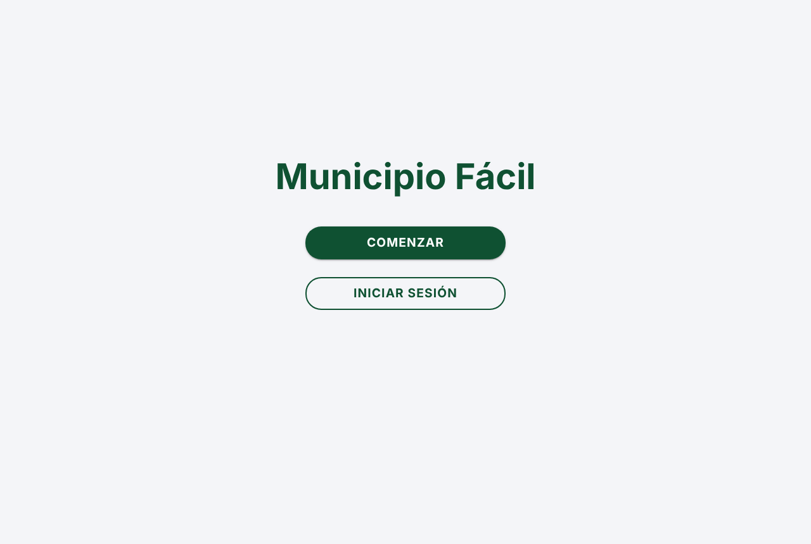
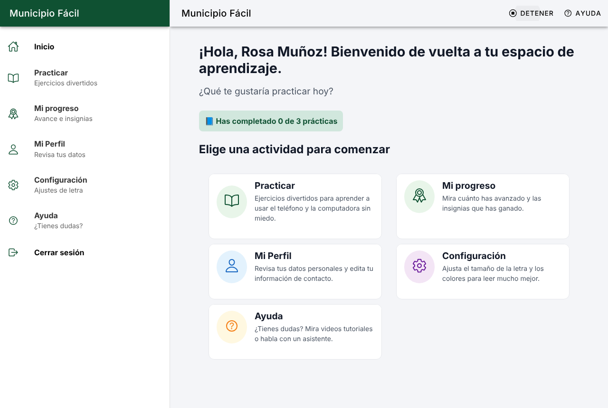
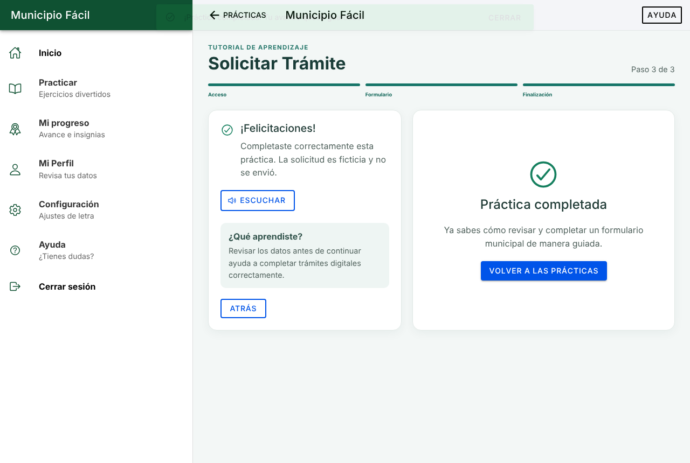
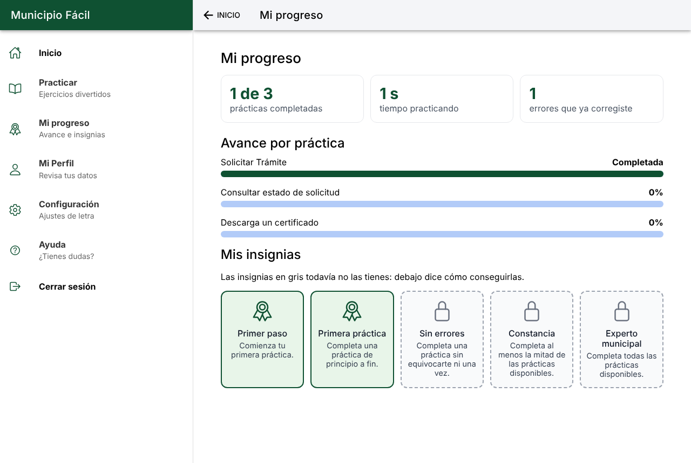
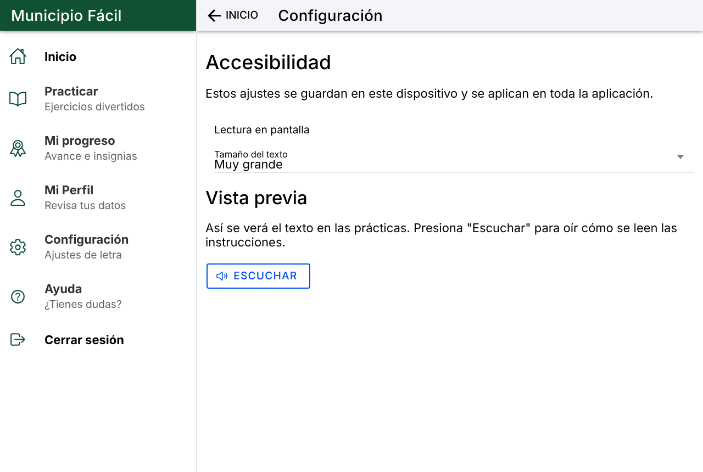
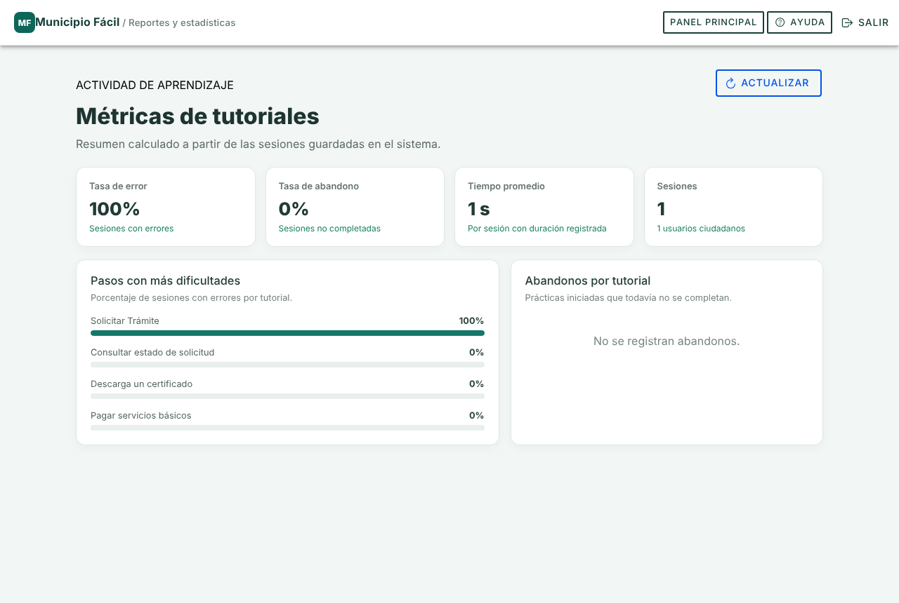
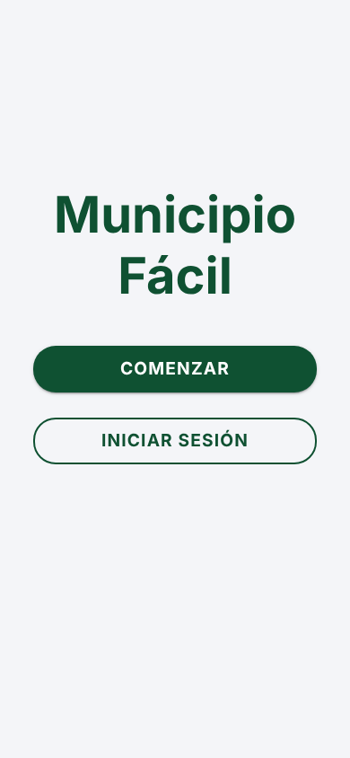
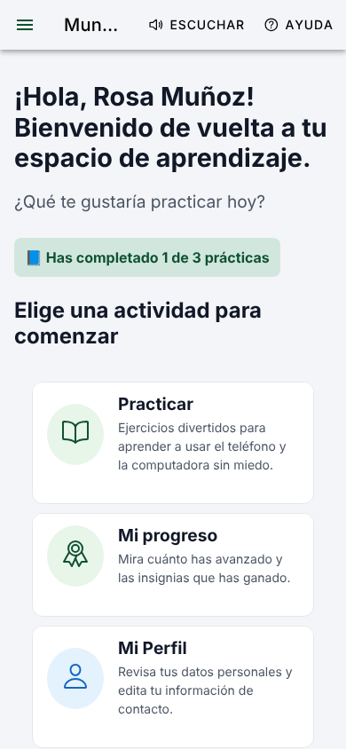
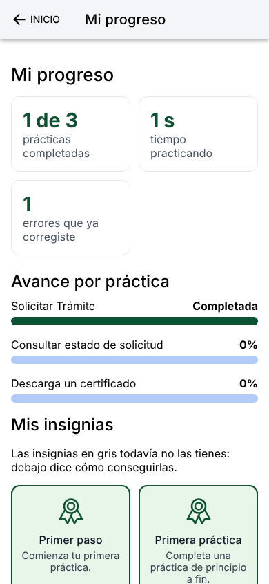

# App de Alfabetización Digital Ciudadana

## Integrantes del Equipo
* [Alexis Parra](https://github.com/AlexisEstebanParraS)
* [Fernando Pacheco](https://github.com/F3rsj)
* [Gabriel Díaz](https://github.com/Gabread)
* [Israel Pérez](https://github.com/Y63431)

---
## Distribución de responsabilidades

Cada integrante es dueño de un corte completo del sistema (base de datos, backend, frontend, pruebas y documentación de su parte), y cada cambio entra por Pull Request revisado por otro integrante.

| Integrante | Corte del sistema | Frontend | Backend |
| :--- | :--- | :--- | :--- |
| Alexis Parra | Flujo del ciudadano | Practicar, Lección, Inicio (avance real) | Progreso con control de dueño |
| Fernando Pacheco | Seguridad y sesión | Cliente HTTP común (`api.ts`), Login, Registro | JWT, CORS, rate limit, XSS, servicio de correo |
| Gabriel Díaz | Administración y datos | Módulos (crear, editar, deshabilitar, eliminar), Usuarios, Métricas | Módulos, usuarios, métricas, `database.sql`, índices |
| Israel Pérez | Despliegue y perfil | Mi Perfil, navegación, Docker del frontend | Perfil (`/usuarios/me`), health, docker-compose |

En la Entrega Parcial 1 el equipo trabajó los prototipos de Figma (Alexis, Gabriel e Israel; la versión web, Fernando) y la documentación (Fernando e Israel).

---
## 1. Justificación del Problema y Usuarios Objetivo (EP 1.2)

### Contexto y Relevancia del Problema
A nivel comunal, el proceso de digitalización municipal ha trasladado trámites esenciales a plataformas en línea. No obstante, esto evidencia la brecha descrita en el **Problema 25: Baja Alfabetización Digital en la Población**, donde segmentos significativos (particularmente adultos mayores y ciudadanos con nula instrucción digital) carecen de las competencias prácticas para utilizar estos sistemas. Las consecuencias directas abarcan exclusión social, dependencia de intermediarios, retrasos en solicitudes críticas (como patentes, permisos o ayudas sociales) e incluso el retraso del proceso de digitalización para acomodar a este sector.

### Evidencia: qué dicen las fuentes

> Esta sección resume **datos de fuentes secundarias**. Los supuestos del equipo están separados más abajo, en "Supuestos de la caracterización".

1. **Los municipios están obligados a digitalizar sus trámites.** La Ley 21.180 de Transformación Digital del Estado (publicada el 11 de noviembre de 2019) modificó la Ley 19.880 para que todo procedimiento administrativo se haga por medios electrónicos [1]. La Ley 19.880 se aplica expresamente a las municipalidades [2]. La misma ley reconoce que hay personas sin acceso o con uso ocasional de medios electrónicos y les permite pedir trámites en papel [1]: el problema existe y el propio Estado lo reconoce.
2. **Las personas mayores usan internet, pero no para hacer trámites.** En la encuesta de SUBTEL 2025 (5.000 casos), el 74,4 % de las personas de 60 años o más usa internet a diario, pero solo el 23,1 % hace trámites con el Estado en línea, frente a un 56 % entre los 30 y 44 años [3].
3. **La brecha está en las habilidades, no solo en la conexión.** En la misma encuesta, el 42,9 % de las personas de 60 años o más sabe hacer pagos o transacciones en línea por sí misma (71,7 % del total), y solo el 19,4 % sabe instalar una aplicación [3]. El 82,9 % de los hogares formados solo por personas mayores tiene internet [3].
4. **La brecha crece con la edad y con menos años de estudio.** La Encuesta Nacional de Calidad de Vida en la Vejez 2022 (UC y Caja Los Andes) muestra que el 23 % de las personas mayores hace trámites por internet, cifra que no supera el 5 % entre quienes tienen más de 80 años o solo educación básica [4]. Usar el banco por internet baja del 40 % (60 a 69 años) al 4 % (80 años o más) [4].

**Qué concluimos:** la conexión ya no es la principal barrera; lo que falta es **práctica guiada** para realizar trámites con confianza. Por eso la aplicación se centra en simular trámites paso a paso, sin riesgo y con retroalimentación inmediata.

#### Referencias

1. Ley N° 21.180, Transformación Digital del Estado. Diario Oficial, 11 de noviembre de 2019. https://www.diariooficial.interior.gob.cl/publicaciones/2019/11/11/42499/01/1680231.pdf
2. Ley N° 19.880, Bases de los Procedimientos Administrativos, artículo 2 (ámbito de aplicación). https://chile.justia.com/nacionales/leyes/ley-n-19-880/gdoc
3. SUBTEL y Cadem. *XII Encuesta de Acceso y Uso de Internet en Chile, medición 2025* (5.000 casos, terreno julio a septiembre de 2025). Tablas 13, 14 y 18. https://www.subtel.gob.cl/wp-content/uploads/2026/02/Informe-Final-Acceso-y-Uso-Internet-2025_03.pdf
4. Pontificia Universidad Católica de Chile y Caja Los Andes. *Sexta Encuesta Nacional de Calidad de Vida en la Vejez 2022*, capítulo 4: Acceso a las TICs. https://encuestacalidaddevidaenlavejez.uc.cl/wp-content/uploads/2023/08/Cap-4-Acceso-a-TICs-1-1.pdf

### Roles del sistema, accesibilidad y supuestos
La aplicación web deberá considerar dentro del sistema, al menos dos roles claramente diferenciados: el **ciudadano o usuario final**, quien interactúa con los módulos de simulación y aprendizaje, y el **funcionario o coordinador de capacitación**, encargado de diseñar y gestionar dichos módulos. El coordinador de capacitación también actuará como **administrador del sistema** para tareas de mantenimiento y configuración.

En cuanto a las necesidades de accesibilidad, seguridad y privacidad, la aplicación deberá ofrecer una interfaz con opciones para aumentar el tamaño del texto, hacer uso de un modo oscuro, activar la narración, activar las notificaciones y cambiar el idioma. También debe contar con protección adecuada de los datos personales ingresados durante las simulaciones de trámites.

#### Supuestos de la caracterización

No hubo contacto directo con usuarios reales. Los perfiles son una **caracterización preliminar** basada en las fuentes anteriores y en estos supuestos razonados, que no son resultados de investigación con usuarios:

| Supuesto | En qué se apoya |
|---|---|
| La persona mayor tiene smartphone e internet, pero no experiencia en trámites en línea | Fuentes [3] y [4]: alto uso diario de internet y bajo uso para trámites |
| Su principal barrera es el miedo a equivocarse, más que la falta de equipo | Inferencia del equipo a partir de [3]: pocas personas mayores saben hacer pagos o instalar aplicaciones por sí mismas |
| Las personas con menos años de estudio y las mayores de 80 son las más rezagadas | Fuente [4] |
| El funcionario municipal puede diseñar y ajustar los módulos sin aprobación de sus superiores | Supuesto del equipo, sin fuente |

### Caracterización y Perfiles de Usuario (Proto-Personas)

#### Proto-Persona 1: Usuario Aprendiz
* **Tipo de usuario / rol:** Ciudadano - Adulto Mayor (Usuario final).
* **Características generales:** 68 años, jubilado, cuenta con un smartphone básico con conexión a internet móvil limitada.
* **Necesidades principales:** Aprender a solicitar horas médicas y certificados municipales sin depender de terceros.
* **Objetivos de uso:** Perder el temor a equivocarse y comprender la simbología de los formularios web.
* **Dificultades y puntos de frustración:** Letra pequeña, botones poco reconocibles, miedo a cometer errores irreversibles o sufrir fraudes, y términos técnicos complejos.
* **Funcionalidades que utilizaría:** Simulador de ingreso de formularios, tutorial con modo guiado por voz/audio y ejercicios de prueba paso a paso con reintentos infinitos.
* **Dispositivo y contexto:** Smartphone Android de gama de entrada, acceso desde el hogar con letra configurada en tamaño grande.

#### Proto-Persona 2: Coordinador de Capacitación
* **Tipo de usuario / rol:** Funcionario / Administrador del sistema.
* **Características generales:** 34 años, asistente social o funcionario del área de desarrollo comunitario de la municipalidad, nivel intermedio-alto de alfabetización digital.
* **Necesidades principales:** Diseñar simulaciones acordes a los trámites vigentes del municipio y evaluar qué pasos generan mayor dificultad en la población.
* **Objetivos de uso:** Disminuir la saturación de atención presencial capacitando virtualmente a los usuarios.
* **Dificultades y puntos de frustración:** Falta de herramientas didácticas para enseñar a personas mayores y baja disponibilidad de métricas claras de aprendizaje.
* **Funcionalidades que utilizaría:** Panel de gestión de módulos formativos, editor de preguntas/pasos de simulación y métricas de finalización.
* **Dispositivo y contexto:** Computador de escritorio o notebook municipal vía navegador web.

---

## 2. Requerimientos del Sistema (EP 1.1)

### Requerimientos Funcionales (RF)
* **RF01 - Catálogo de Trámites Simulados (Usuario):** El sistema debe listar los módulos interactivos de trámites municipales disponibles (ej. reserva de horas, solicitud de certificados, pago de aseo) con indicadores visuales de nivel de dificultad.
* **RF02 - Simulador Guiado de Formularios (Usuario):** El sistema guía al usuario paso a paso por un formulario de trámite simulado, valida cada campo antes de continuar y destaca el siguiente elemento con el que debe interactuar.
* **RF03 - Asistente de Lectura y Ayuda Contextual (Usuario):** El sistema lee en voz alta, al presionar "Escuchar", las instrucciones de cada paso de la práctica y las opciones de la pantalla de inicio, en español y a una velocidad pausada.
* **RF04 - Retroalimentación Inmediata de Errores (Usuario):** El sistema debe entregar mensajes de corrección claros y libres de tecnicismos cuando el usuario cometa una equivocación durante la simulación, permitiendo reintentos ilimitados.
* **RF05 - Historial y Progreso Formativo (Usuario):** El sistema registra el avance de cada práctica (paso, errores, tiempo y estado) y lo muestra en la pantalla "Mi progreso" con barras de avance e insignias.
* **RF06 - Crear Módulos de Capacitación (Admin):** El sistema permite al administrador crear un módulo de práctica con título, descripción, dificultad, cantidad de pasos y estado inicial.
* **RF07 - Modificar Módulos de Capacitación (Admin):** El sistema permite al administrador modificar los datos de un módulo existente.
* **RF08 - Habilitar o Deshabilitar Módulos (Admin):** El sistema permite al administrador ocultar un módulo a la ciudadanía (deshabilitarlo) o volver a mostrarlo, sin perder el progreso registrado.
* **RF09 - Métricas de Errores y Usabilidad (Admin):** El sistema genera reportes agregados que indican qué pasos de los simuladores presentan la mayor tasa de fallos o abandono.
* **RF10 - Gestión de Cuentas (Admin):** El sistema permite al administrador desactivar o reactivar la cuenta de un ciudadano; una cuenta desactivada no puede iniciar sesión.

### Requerimientos No Funcionales (RNF)
* **RNF01 - Usabilidad y Accesibilidad:** La interfaz debe cumplir con criterios de contraste accesible (WCAG AA), tipografía escalable con un tamaño base no inferior a 16px y áreas táctiles de botones de al menos 48x48px.
* **RNF02 - Rendimiento:** Las vistas y recursos iniciales deben cargar en un tiempo inferior a 2.5 segundos bajo redes móviles estándar (3G/4G).
* **RNF03 - Diseño Adaptable (Responsividad):** La interfaz debe ajustarse sin pérdida de consistencia funcional entre pantallas móviles (desde 360px de ancho) y navegadores web de escritorio.
* **RNF04 - Seguridad y Privacidad de Datos:** Los datos que se escriben en los formularios de práctica no salen del navegador: la lección envía al servidor solo 4 valores (paso, errores, tiempo y completado), verificable en la pestaña Red del navegador. Las contraseñas se guardan con bcrypt (costo 10), el token de sesión expira en un máximo de 2 horas y se borra al cerrar la pestaña, y el servidor responde 429 tras 10 solicitudes de inicio de sesión desde una misma IP en 15 minutos.
* **RNF05 - Compatibilidad Multiplataforma:** La aplicación funciona en las versiones vigentes de Chrome, Edge, Firefox y Safari, en pantallas desde 360 px hasta 1920 px de ancho sin desplazamiento horizontal, y puede empaquetarse como app Android/iOS con Capacitor.

---

## 3. Instrucciones de Instalación y Ejecución

### Prerrequisitos
* **Node.js**: Versión 18 o superior LTS instalada (descargar desde [nodejs.org](https://nodejs.org/)).
* **Git**: Instalado en el sistema para la gestión del repositorio.

### Pasos para clonar y ejecutar el frontend

1. **Clonar el repositorio y entrar al proyecto:**
   ```bash
   git clone https://github.com/Y63431/Alfabetizacion-Web.git
   cd Alfabetizacion-Web
   ```

2. **Situarse en la rama frontend**
   ```bash
   git checkout frontend
   ```

3. **Instalar dependencias**
   ```bash
   npm install
   ```

4. **Configurar la URL de la API**
   ```bash
   cp .env.example .env
   ```

   | Variable | Descripción | Ejemplo |
   |---|---|---|
   | `VITE_API_URL` | URL base de la API del backend | `http://localhost:3000/api` |

   El backend (rama `backend`) debe estar corriendo, y su variable `FRONTEND_ORIGIN` debe ser la dirección del frontend (por defecto `http://localhost:5173`, la de `npm run dev`; con `ionic serve` es `http://localhost:8100`). CORS compara protocolo + host + puerto: si abres el frontend en otro puerto, cambia esa variable.

5. **Ejecutar servidor local**
   ```bash
   npm run dev                 # Vite, en http://localhost:5173
   # o bien
   npx @ionic/cli serve        # Ionic, en http://localhost:8100
   ```

6. **Pruebas**
   ```bash
   npx vitest run              # pruebas unitarias (servicios y rutas protegidas)
   npm run lint
   ```

### Integración con la API

Todas las llamadas protegidas pasan por `src/services/api.ts`, que agrega el JWT (`Authorization: Bearer`), convierte los errores del backend en mensajes claros y, ante un `401` (token inválido o expirado), cierra la sesión y vuelve al inicio de sesión. La sesión se guarda en `sessionStorage`, así que se cierra al cerrar la pestaña.

| Pantalla | Endpoints | Rol |
|---|---|---|
| Registro / Login | `POST /auth/registro`, `POST /auth/login` | Público |
| Inicio | `GET /modulos`, `GET /progreso` | Ciudadano |
| Practicar | `GET /modulos`, `GET /progreso` | Ciudadano |
| Lección | `GET /modulos/:id`, `POST /progreso`, `PATCH /progreso/:id` | Ciudadano |
| Mi Perfil | `GET /usuarios/me`, `PUT /usuarios/me` | Ciudadano |
| Usuarios (admin) | `GET /admin/usuarios`, `PATCH /admin/usuarios/:id` | Admin |
| Métricas (admin) | `GET /admin/metricas` | Admin |
| Módulos (admin) | `GET`, `POST`, `PUT`, `PATCH`, `DELETE /modulos` | Admin |

La Lección registra el avance real: al abrirla inicia (o retoma) el progreso, cada envío del formulario con errores suma a `errores_cometidos`, y al terminar guarda el tiempo y marca el módulo como completado. Esos datos alimentan las métricas del administrador.

### Docker

El `Dockerfile` tiene dos etapas: Node.js ejecuta `npm run build` y la imagen final solo contiene Nginx con los archivos de `dist/`. `nginx.conf` usa `try_files … /index.html` para que se puedan recargar las rutas de React Router. Nginx entrega los archivos; el JavaScript de React se ejecuta en el navegador.

Se levanta junto con la API y la base de datos con el `docker-compose.yml` de la rama `backend` (ver su README). Para probar solo esta imagen:

```bash
docker build -t municipio-facil-web .
docker run --rm -p 127.0.0.1:8080:80 municipio-facil-web
```

La app queda en `http://localhost:8080`, y la API debe tener `FRONTEND_ORIGIN=http://localhost:8080`.

## 4. Bocetos de UI/UX y prototipo en Figma (EP 1.3)
Este objetivo se cumplió de forma **parcial**, considerando únicamente las pantallas que a la fecha ya se encuentran codificadas. Para cada una de ellas se elaboró de forma manual, en Figma, el mockup correspondiente a una funcionalidad definida previamente en los requerimientos del proyecto, con un diseño diferenciado y coherente con el flujo de navegación y la jerarquía de información.
Los diseños contemplan explícitamente la **versión móvil** y la **versión web**, evidenciando la distribución del contenido, los componentes de navegación (menú lateral en web y barra inferior en móvil) y la densidad de la información. La construcción se realizó exclusivamente con las herramientas convencionales de Figma (marcos, componentes, estilos, Auto Layout y conexiones de prototipado), sin recurrir al asistente de IA de Figma ni a otras herramientas de IA generativa.

Link a Mockups [Figma](https://www.figma.com/design/u9nffOZTdsYh1RBRvRnf2z/Alfabetizacion-Web?m=auto&t=Ux02yCFqAIKCVX0t-1)

## 5. Definición de Arquitectura de Navegación y Experiencia del Usuario. (EP 1.4)
la arquitectura de navegación de **Municipio Fácil**: estructura de rutas, jerarquía de vistas y flujo de interacción entre pantallas, tomando como base el prototipo de Figma (versión web) y los requerimientos funcionales definidos en este README.


La versión móvil en desarrollo.
### a) Rutas principales y secundarias

Todas las rutas están en `src/routes/AppRoutes.tsx`. Las protegidas pasan por `ProtectedRoute`, que exige sesión y el rol correcto; si el rol no corresponde, redirige al inicio de ese rol.

| Ruta | Pantalla | Acceso |
|---|---|---|
| `/` y cualquier ruta desconocida | Redirección a `/bienvenida` | Público | — |
| `/bienvenida` | Bienvenida | Público |
| `/iniciar-sesion` | Inicio de sesión del ciudadano | Público |
| `/admin/iniciar-sesion` | Inicio de sesión del administrador | Público |
| `/registro` | Registro guiado en etapas (nombre; correo y contraseña; confirmación) | Público |
| `/ayuda` | Ayuda | Público |
| `/inicio` | Inicio del ciudadano | Ciudadano |
| `/practicar` | Catálogo de prácticas | Ciudadano |
| `/practicar/:moduloId` | Lección guiada de un módulo | Ciudadano |
| `/mi-progreso` | Avance e insignias | Ciudadano |
| `/perfil` | Mi Perfil | Ciudadano |
| `/configuracion` | Accesibilidad (tamaño de letra) | Ciudadano |
| `/admin/panel` | Panel de administración | Admin |
| `/admin/modulos` | Gestión de módulos | Admin |
| `/admin/usuarios` | Gestión de usuarios | Admin |
| `/admin/metricas` | Métricas de aprendizaje | Admin |
| `/admin/configuracion` | Configuración del administrador | Admin |

### b) Relaciones jerárquicas entre vistas
- La arquitectura avanza desde un Nivel 0 público de autenticación, hacia un Nivel 1 centralizado que sirve como panel de control para acceder a las        funcionalidades del Nivel 2. Todo el flujo se apoya en un menú lateral dinámico, que se mantiene oculto durante el acceso y se activa únicamente al iniciar sesión.

1. **Nivel 0 – Acceso:** `/bienvenida` → `/iniciar-sesion` o `/registro` (con sus 3 etapas internas manejadas por estado, no por sub-rutas).
2. **Nivel 1 – Inicio:** `/inicio` es la única vista posterior al login/registro, y actúa como raíz real (aunque hoy sin hijos navegables) de la experiencia autenticada.
3. **Menú lateral:** implementado con `IonSplitPane` + `IonMenu` (`MenuLateral.tsx`), oculto en rutas públicas (`rutasPublicas = ['/bienvenida', '/iniciar-sesion', '/registro', '/']`) y visible en el resto, calculado dinámicamente según `location.pathname`.
**Diseñado, planificado (según diagrama de flujo):**
4. **Nivel 2 – Funcionalidades de Usuario:** desde `/inicio` se desprenden como hijos directos y paralelos: Perfil, Configuración, Tutoriales y Ayuda.
5. **Nivel 3 – Tutoriales:** Tutoriales se abre en un nivel adicional hacia cada módulo (Tutorial 1 a 4).
6. **Subárbol paralelo del Administrador:** estructura desacoplada del flujo ciudadano. Se accede mediante `/admin/iniciar-sesion` y conduce al tablero `/admin/panel`, desde el cual se ramifican de forma horizontal y en el mismo nivel jerárquico las vistas de *Gestión de módulos*, *Métricas y estadísticas* y *Gestión de usuarios* — igual de paralelas entre sí que las secciones del Usuario, sin que una dependa de otra para ser accedida.

Todo el bloque de Administrador (rutas, componentes, panel) no existe aún en el código; su implementación real corresponde a EP2.5, junto con la protección de rutas por rol.

### c) Flujo de navegación entre funcionalidades
1. **Flujo de primer uso / onboarding:** `/bienvenida` → "Comenzar" → `/registro` → completa secuencialmente nombre y credenciales (con validación en cada etapa) → pantalla de confirmación → "Continuar" → `/inicio`.

2. **Flujo de autenticación recurrente:** `/bienvenida` → "Iniciar sesión" → `/iniciar-sesion` → credenciales → `/inicio`.

3. **Exploración no lineal:** una vez conectadas las rutas, desde `/inicio` la interacción será libre y abierta — el usuario podrá dirigirse indistintamente a Perfil, Configuración, Tutoriales o Ayuda sin un orden predeterminado.

4. **Simulación secuencial de trámites:** al seleccionar un ejercicio en `/practicar`, el sistema impondrá un avance ordenado (Paso 1: Portal → Paso 2: Formulario → Validación y corrección → Paso 4: Finalización), permitiendo retroceder en todo momento.

5. **Acceso del Administrador:** desde `/admin/panel`, el Coordinador podrá dirigirse directamente y sin orden obligatorio a Gestión de módulos, Métricas y estadísticas o Gestión de usuarios.

### d) Diferenciación de acceso según roles
**Implementado actualmente:**
El código **no diferencia roles todavía**. Toda persona que inicia sesión (/iniciar-sesion) o completa el registro (/registro) llega exactamente a la misma vista.
**Diseño planificado**
- **Usuario:** ingresará por `/iniciar-sesion` o completará el registro, y será dirigido a `/inicio`, con acceso a Practicar, Mi Perfil, Configuración y Ayuda
- **Administrador:** ingresará por una pantalla de login independiente (`/admin/iniciar-sesion`, ya diseñada en los mockups como "Acceso Seguro") y será dirigido a `/admin/panel`, con acceso exclusivo a Gestión de módulos (Métricas y estadísticas, Gestión de usuarios).

### e) Flujo de principales tareas (task flow)
El estado actual presentara 4 task flows, es decir que estarn imlementada en codigo 

**Task flow 1 – Registro de un nuevo usuario:**
`/bienvenida` → "Comenzar" → `/registro` (etapa 1: nombre, válido) → etapa 2: correo y contraseña (válido) → etapa 3: "¡Felicidades!" → botón "Continuar" → `/inicio`.


**Task flow 2 – Corrección de un dato faltante:**
En cualquier etapa de `/registro`, si el campo está vacío o las contraseñas no coinciden → mensaje "Todavía falta un dato" → corrección sobre el mismo formulario.

**Task flow 3 – Uso del explicador guiado:**
Etapa 1 o 2 de `/registro` → botón "Ver la explicación" / "Ver explicación guiada" → pasos numerados (PASO 1, PASO 2...) → botón "Cerrar explicación y escribir" → vuelve al formulario sin perder el progreso.

**Task flow 4 – Inicio de sesión:**
`/bienvenida` → "Iniciar sesión" → `/iniciar-sesion` → completar correo/teléfono y contraseña → botón "Iniciar Sesión" → `/inicio`.

**Diseñado, planificado:**

**Task flow 5 – Ejecución de tutorial interactivo:**
`/inicio` → `/practicar` → selección de lección ("Solicitar Trámite") → fase explicativa → formulario de prueba → corrección formativa ante errores → resumen pedagógico final.

**Task flow 6 – Ajuste de accesibilidad:**
`/inicio` → "Configuración" → `/configuracion` → ajustar tamaño de letra, modo oscuro, notificaciones, sonido de voz o idioma → "Guardar Configuración".

**Task flow 7 – Acceso y gestión (Administrador):**
`/admin/iniciar-sesion` → `/admin/panel` → selección directa entre "Gestión de módulos", "Métricas y estadísticas" o "Gestión de usuarios".


### f) Puntos críticos de interacción
**Implementados para Entrega parcial 1**
- **Validación por etapa en `/registro`:** usa mensajes claros y sin tecnicismos ("No has puesto tu nombre. No pasó nada: puedes corregirlo ahora"), y nunca borra lo que el usuario ya escribió al mostrar un error.
- **Visibilidad condicional del menú lateral:** se calcula en cada render a partir de `location.pathname`; agregar una nueva ruta pública sin sumarla a `rutasPublicas` haría aparecer el menú donde no corresponde, por lo que es un punto que requiere disciplina al escalar el proyecto.

- **Pendiente por hacer**
- **Botones sin ruta asignada (Practicar, Mi Perfil, Configuración, Ayuda):** hoy son visualmente completos pero no navegables; deben conectarse antes de EP1.6 para cumplir con el mínimo de 4 pantallas navegables exigido por la pauta.
- **Único punto de entrada al subárbol de Administrador (Gestión de módulos):** al no existir accesos directos paralelos desde el panel raíz, un fallo o lentitud en la carga de "Gestión de módulos" bloquearía el acceso tanto a Métricas y estadísticas como a Gestión de usuarios; se deberá evaluar en EP2 si esta jerarquía anidada afecta la eficiencia de uso del Coordinador de Capacitación.
- **Verificación de rol en rutas protegidas:** el `PrivateRoute` que se implementará en EP2.5 será el punto crítico de seguridad más importante del sistema, ya que un error en la validación del JWT podría exponer rutas de Administrador a un Usuario común.

### g) Coherencia de experiencia entre dispositivos
El uso de `IonSplitPane` permite que el mismo menú lateral (`MenuLateral.tsx`) se comporte como panel fijo en pantallas anchas (web/escritorio) y como menú deslizable tipo overlay en pantallas angostas (móvil), sin duplicar código de navegación. Los encabezados con botones "Lectura" y "Ayuda" (`IonButtons slot="end"`) se repiten de forma consistente en `Login.tsx`, `Registro.tsx` e `Inicio.tsx`.

### h) Justificación técnica de las decisiones de arquitectura
- **Usabilidad:** manejar el registro como una sola ruta con estado interno (`etapa`) evita que el usuario pierda su progreso al usar el botón "atrás" del navegador entre etapas, algo crítico para la Proto-Persona "Usuario Aprendiz".
- **Eficiencia de interacción:** la validación ocurre en el cliente antes de avanzar de etapa (`validarNombre`, `validarCredenciales`).
- **Claridad estructural:** separar el menú lateral como componente independiente (`MenuLateral.tsx`), y ocultarlo condicionalmente según la ruta, facilita escalar el proyecto sin reescribir la lógica de layout.

**Decisiones de diseño a aplicar en próximas entregas:**
- **Escalabilidad:** dejar los ítems Practicar, Mi Perfil, Configuración y Ayuda ya visibles en el menú y en `Inicio.tsx` —aunque todavía sin ruta— permite conectarlos progresivamente sin rediseñar la navegación general ya construida.
- **Seguridad y claridad de roles:** concentrar toda la lógica de diferenciación de roles en un único componente `PrivateRoute` (en vez de repetir validaciones en cada vista) reducirá el riesgo de inconsistencias al conectar el backend en EP2.
- **Jerarquía anidada del Administrador:** modelar "Gestión de módulos" como nodo intermedio entre el panel raíz y sus dos subsecciones (en vez de dejarlas como accesos paralelos).

---

## 6. Capturas de la aplicación

Capturas tomadas de la aplicación funcionando con el backend real (prueba de punta a punta en Chrome).

### Versión web

| Bienvenida | Inicio del ciudadano |
|---|---|
|  |  |
| **Lección completada** | **Mi progreso** |
|  |  |
| **Configuración con letra muy grande** | **Métricas del administrador** |
|  |  |

### Versión móvil (390 × 844)

| Bienvenida | Inicio | Mi progreso |
|---|---|---|
|  |  |  |

---

## 7. Rendimiento y accesibilidad

### Accesibilidad (RNF01)

| Mejora | Cómo se implementó |
|---|---|
| Zoom en el celular | `index.html` impedía ampliar la pantalla (`user-scalable=no`, `maximum-scale=1.0`). Para personas mayores poder ampliar es esencial, así que se quitó |
| Tamaño de letra que se mantiene | La pantalla Configuración guarda la preferencia en `localStorage` (`services/preferencias.ts`) y `main.tsx` la aplica antes de mostrar la primera pantalla. localStorage se usa solo para esta preferencia, no para datos personales |
| Lectura en voz alta (RF03) | Componente `BotonLectura` con la síntesis de voz del navegador (`window.speechSynthesis`), en español de Chile |
| Avisos claros | Componente `Aviso` (`IonToast`) con el resultado de cada acción; los lectores de pantalla lo anuncian |

### Rendimiento (RNF02)

- **Build de producción con Vite:** `npm run build` prepara HTML, JavaScript y CSS optimizados en `dist/`. Con Docker, Nginx entrega esos archivos y el navegador ejecuta React.
- **Menos datos por respuesta:** la API devuelve solo las columnas necesarias, filtra en la base de datos (el ciudadano recibe solo los módulos habilitados y su progreso) y permite paginar con `?page=&limit=`.
- **Re-render en vez de recarga:** al cambiar el estado (`useState`), React actualiza solo la parte de la interfaz que cambió; navegar entre rutas no recarga la página (SPA).

**Cómo comprobar el tiempo de carga:** con `npm run build` y `npx vite preview`, abrir `http://localhost:4173/bienvenida`, ir a las herramientas de desarrollo del navegador (F12) → pestaña **Network**, marcar *Disable cache*, elegir la velocidad *Fast 4G* y recargar. El valor **Load** de la parte inferior debe ser menor a 2,5 s (RNF02).
